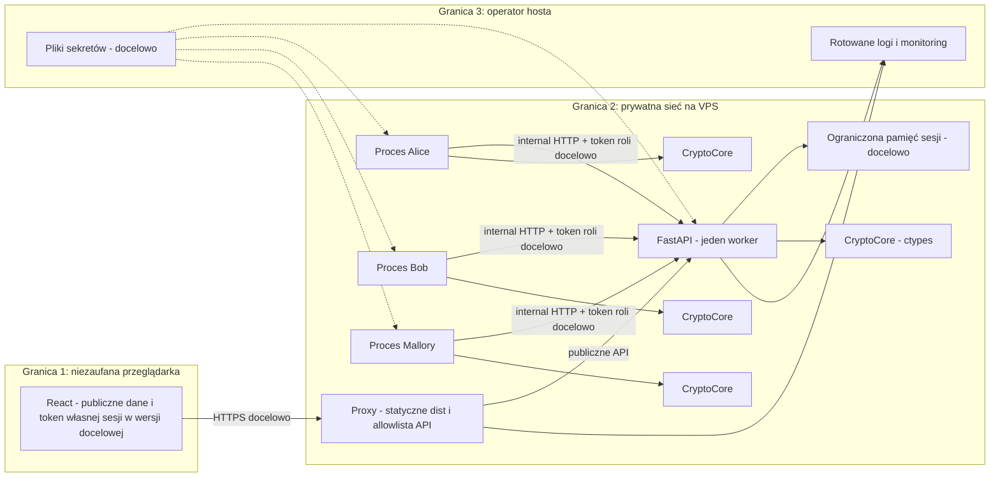
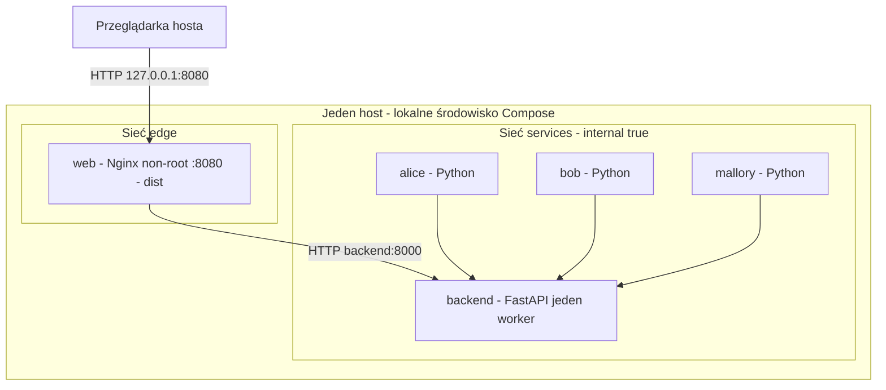

# Wdrożenie RADH — audyt, środowisko lokalne i cel publicznej bety

Stan audytu: `main` a37d066, 2026-11-17. **Compose w #73 uruchamia obecną
jednosesyjną aplikację v1. Nie jest wdrożeniem publicznej bety.**
Kontrakt docelowy: [multi-session.md](multi-session.md). Ocena ryzyka:
[threat-model.md](../security/threat-model.md). Publikacja wymaga
[release-gate.md](../security/release-gate.md).

## Obecna architektura — potwierdzone fakty

- C11/CMake buduje bibliotekę współdzieloną. Brak stanu globalnego C; wyniki
  i wskaźniki należą do wywołującego, walidacja oraz zapis dopiero po sukcesie.
  Python ładuje bibliotekę przez ctypes (ścieżka z env lub katalog build),
  sprawdza typy/zakresy przed konwersją i mapuje statusy na wyjątki.
- FastAPI ma jeden `SessionStore.session`, globalną pamięć obecności i
  historię `used_ids` bez cleanupu. Jeden worker jest wymaganiem poprawności.
  REST RSA jest bezstanowy; DH demo jest centralną funkcją wyłącznie matematyczną.
- Jeden proces Alice, Bob, Mallory obsługuje po jednej sesji. Ich klient HTTP
  odpytuje `/current`, publikuje, pobiera wiadomość i ACK; Mallory ma osobny forward.
  Osobny wątek heartbeat nie wykonuje operacji na stanie kryptograficznym.
- Protokół nie zawiera prywatnych wykładników. Diagnostyka K jest jawna,
  opcjonalna i odrębna; backend nie dowodzi równości K. Nie ma auth, limitów
  sesji/CPU i bezpiecznego publicznego dostępu do cudzych rekordów.
- React nie oblicza RSA/DH. Formularz RSA/keygen wywołuje backend; DH polluje
  stan co 1 s i obecność co 3 s. Vite proxy działa tylko w development.
  Produkcyjne pliki `dist` potrzebują własnego reverse proxy.
- CI: jeden job buduje C/CTest i uruchamia pytest, drugi lint/build frontendu.
  Brak obrazów, skanu zależności, SBOM, publikacji czy TLS w dotychczasowym repo.
  Testy obejmują rzeczywiste procesy i retry normal/MITM, nie wielu właścicieli.
  Po reorganizacji testów zauważono niespójny cel monkeypatch w
  `tests/test_dh_nodes/test_session_fixture.py`: import fixture przez
  `tests.test_dh_nodes.test_sessions`, cel `test_sessions.TestClient`.
  To zależność do przeglądu QA, nie poprawka produkcyjna wykonywana w #73.
- Dokumenty DH_SESSIONS/MITM_SESSIONS opisują v1; `nodes/README` opisuje również
  lokalne JSON Lines, które nie wysyła heartbeatów. Nie zastępować nimi transportu HTTP.

## Diagram komponentów i granic

Operator/root hosta może odczytać pamięć procesów i sekrety, dlatego jest zaufany.
Węzły są zaufane do własnej roli, nie do przejmowania ról innych węzłów.
Wspólny obraz nie oznacza wspólnego procesu lub współdzielenia pamięci.

## Lokalny Compose dodany w #73

Pliki: `compose.yaml`, `.dockerignore`, `.env.example`, `deploy/runtime.Dockerfile`,
`deploy/web.Dockerfile`, konfiguracja Nginx, entrypoint i healthcheck.
Backend i trzy węzły używają tego samego zbudowanego obrazu runtime, ale startują
jako cztery odrębne kontenery/procesy. Domyślne losowanie sekretów pozostaje w węzłach.
Brak zmian implementacji aplikacji, C i frontendu dla #68–71.

`services` nie ma wyjścia do Internetu. `web` jest dodatkowo w edge, aby można
było opublikować port; nie jest routerem IP i nie dostaje NET_ADMIN.
Port backendu nie jest publikowany. Ujawniony jest wyłącznie
`127.0.0.1:${RADH_HTTP_PORT:-8080}`. Nie używać host networking, `privileged`,
montowania docker.sock ani hostowego katalogu projektu do runtime.
Każdy proces działa jako non-root; capabilities usunięte, no-new-privileges,
read-only root, mały tmpfs, ograniczone PID/CPU/RAM, logi max. 3×10 MB/usługę.
Nie oznacza to izolacji sesji użytkowników w v1; inny lokalny użytkownik hosta
nadal może korzystać z globalnej sesji przez ten port.

Proxy dopuszcza istniejące operacje UI: RSA/keygen/DH demo, tworzenie/start/cancel
sesji i odczyty, w tym **GET `/api/v1/dh/sessions/current`** z istniejącym
limiterem i konfiguracją proxy. Ten odczyt umożliwia UI odzyskanie ID i anulowanie
sesji po odświeżeniu strony; pozostałe metody `/current` są blokowane (403).
Endpoint zniknie dopiero przy migracji do v2 w #68–70. Proxy nie wystawia
heartbeatów, publikowania/ACK/forward ani zapisu diagnostyki. Węzły korzystają bezpośrednio z `http://backend:8000`.
Istniejące API aplikacji nadal nie ma autoryzacji, proxy nie dopisuje fikcyjnych
poświadczeń. Lokalny limiter proxy (20 r/s/IP, burst) i limit body 4 KiB nie są
implementacją pełnego admission control z kontraktu wielosesyjnego.
Brak TLS i tokenów w tej konfiguracji jest celowy i wyklucza jej publiczne użycie.

### Powtarzalność buildów i wersje

| Obraz / zależności | Wersja domyślna | Uzasadnienie |
| --- | --- | --- |
| Python | `python:3.12.16-slim-bookworm` | Linia 3.12 zgodna z CI; ten sam glibc w builderze i runtime C |
| Node | `node:22.23.5-bookworm-slim` | Linia 22 zgodna z CI i wymaganiem Vite >=22.12; wyłącznie builder |
| Nginx | `nginx:1.30.6-alpine3.24` | Jawna wersja stabilnej linii, mały runtime statycznych plików |
| npm | `frontend/package-lock.json` + npm ci | Istniejący lock bez zmiany zależności Szymona |
| Python runtime | `deploy/requirements.lock` | Pełny snapshot istniejącego backend/.venv, zgodny z zakresami backend/requirements.txt |

Tagi zweryfikowano w oficjalnych indeksach [Python](https://raw.githubusercontent.com/docker-library/official-images/master/library/python),
[Node](https://raw.githubusercontent.com/docker-library/official-images/master/library/node),
[Nginx](https://raw.githubusercontent.com/docker-library/official-images/master/library/nginx).
Tag z numerem patch może być ponownie zbudowany przez wydawcę: to ogranicza dryf,
ale nie zapewnia bitowej identyczności. **Przed publiczną betą** operator zapisuje
manifesty multiarch/digesty z rzeczywiście pobranych obrazów, skanuje je i używa
`image@sha256:...`; nie wpisujemy wymyślonych digestów. apt korzysta z bieżących
repozytoriów Debiana, lock Python nie zawiera hashy artefaktów. Reprodukowalność
bitowa (snapshot apt, hashe pip) to jawnie nierozwiązany element release gate.

Builder kompiluje i testuje C, instaluje zamrożone zależności do prefixu. Runtime
nie zawiera kompilatora ani źródeł C; ma bibliotekę .so w stałej ścieżce env.
Osobny builder Node wykonuje lint/build. Do Nginx trafiają tylko `dist` i konfiguracja.
Allowlista `.dockerignore` wyklucza .git, .env, klucze, venv, node_modules, buildy
hosta, testy i niezwiązane lokalne dokumenty (np. RACI.md).
Lock jest punktem startowym, nie dowodem braku podatności; aktualizacje w
oddzielnym przeglądzie QA/bezpieczeństwa, nie automatycznie `latest` przy deployu.

### Konfiguracja i healthchecki v1

- `.env.example`: tylko port, tag lokalnego obrazu, `RADH_DIAGNOSTICS=0|1`.
  Nie ma działających dziś tokenów usług; nie dodawać atrap sugerujących auth.
- URL koordynatora ustawiony w Compose na nazwę usługi `backend`; nie localhost.
- `RADH_DIAGNOSTICS=1` dodaje flagę `--allow-diagnostics` dla każdego węzła.
  Bez tego UI pokazuje, że K zostało w procesie. Nie włączamy test-mode w Compose.
- Sonda backendu: HTTP `/openapi.json`, obecność trasy keygen, ładowanie CryptoCore
  i symbolu keygen. Nie zmienia stanu sesji i nie wykonuje kosztownej wymiany.
- Sonda węzła: PID 1 istnieje oraz jego rola ma świeży heartbeat u koordynatora.
  Nie wysyła sztucznego heartbeat w imieniu procesu. W v1 może być oszukana przez
  inny proces tej roli — docelowo instance_id i auth rozwiążą tę lukę.
- Sonda proxy: GET `/healthz` — sprawdza tylko proxy. Pełna gotowość wymaga też
  healthy backend i online wszystkich potrzebnych ról. Healthcheck 10 s/3 retry;
  unhealthy nie uruchamia automatycznie restartu w Compose.
- `depends_on: service_healthy` porządkuje start, ale nie obsługuje późniejszej
  awarii. `restart: unless-stopped` restartuje zakończone procesy, nie unhealthy.
  Operator monitoruje sondy i rozstrzyga zawieszenie; restart backendu traci sesję,
  restart węzła traci wykładnik. Anuluj starą sesję i utwórz nową.

## Docelowy VPS po #68–71 — nie jest implementowany w Compose v1

Jedna maszyna Linux, początkowo 2 vCPU/4 GiB RAM, bez Kubernetesa i bez bazy.
Nginx (lub równoważny pojedynczy proxy) serwuje dist i kończy TLS 1.2/1.3.
Certyfikat ACME odnawiany przez operatora/systemd, sprawdzenie ważności i próbne
odnowienie; klucz TLS tylko w chronionym pliku, montowany read-only. Hostname
jawnie dopuszczony. 443 publiczne; 80 wyłącznie redirect/ACME, SSH tylko z adresów
administratora. Nigdy nie publikować 8000, 8080 wewnętrznego, panelu Docker ani metryk.
Po sprawdzeniu HTTPS włączyć HSTS; nie na lokalnym HTTP.

Backend pozostaje jednym procesem z chronionym publicznym routerem v2 i
wewnętrznym routerem z tokenami ról. Publiczny proxy ma allowlistę v2 oraz RSA,
blokuje legacy sesje v1, `/internal`, docs i schema. Forwarded headers są
nadpisywane przez proxy, a backend ufa wyłącznie konkretnemu adresowi/CIDR proxy.
Nie ufać `X-Forwarded-For` z Internetu ani stosować `forwarded-allow-ips=*` bez
izolacji listenera. Obecny Compose wyłącza zaufanie do proxy headers całkowicie;
limity IP w docelowym backendzie wymagają zmiany konfiguracji po #69.

### Sekrety, zasoby, logi

Tokeny ról generuje operator (`secrets.token_urlsafe(32)`), trzy niezależne pliki
z dostępem tylko dla odpowiedniego UID; backend dostaje ich skróty lub prywatne
pliki konfiguracyjne. Bez ARG/ENV podczas builda, obrazu, frontendu i Git.
Docelowe ścieżki `_FILE` opisuje kontrakt; aktualny kod ich jeszcze nie obsługuje.
W Sprincie A dopuszczamy wymianę tokenów ról z zatrzymaniem/restartem usług
oraz fencing; rotacja bez przestoju z maks. 60 s nakładania tokenów to follow-up
operacyjny obowiązkowy przed publikacją (G13), poza implementacją #68–71.
Owner tokeny powstają na serwerze w #69 i są ograniczone do życia sesji.
Hasło do TLS/ACME, token roli i prywatny wykładnik edukacyjny to różne aktywa.

Limity początkowe kontenerów: backend 1 CPU/512 MiB/64 PID, każdy węzeł
0,5 CPU/256 MiB/64 PID, proxy 0,5 CPU/128 MiB/32 PID; 16 MiB tmpfs/usługę.
To górne limity, nie rezerwacje, suma może przewyższać 2 vCPU — wymagany pomiar
sprawiedliwości pod obciążeniem. Limity backendu sesji/żądania z multi-session
są konieczne niezależnie od cgroups. Kernel OOM może zabić proces i utracić sesje.

- Monitorować: 5xx/429, p95 latency, CPU/RSS/PID, liczbę sesji i węzłów,
  rozmiar cache/tombstone, wygaśnięcia, brak heartbeat >10 s, restarty/OOM,
  ważność TLS i miejsce na logi. Metryki bez etykiet session_id/token/IP.
- Docelowy prywatny `/internal/metrics` (osobne PBI operacyjne) lub mały hostowy
  collector; brak Prometheusa nie może oznaczać braku alarmów. Do bety wystarczy
  chroniony monitoring hosta i syntetyczne sondy. W #73 nie dodano endpointu metrics.
- Alarmy początkowe: >1% 5xx przez 5 min, p95>2 s przez 5 min, RSS>80% limitu
  przez 5 min, rola offline>30 s, dysk>80%, certyfikat<14 dni. Dostosować po pomiarze.
- Logi strukturalne: UTC, request_id wygenerowany/zwalidowany przez serwer,
  kod operacji/status/latency, pseudonim sesji z okresowo rotowanym kluczem;
  bez Authorization, Idempotency-Key, body, query, K i wykładników. Retencja
  docelowo 7 dni, dostęp operatora, kasowanie. Nginx access log w Compose nie
  zapisuje URI ani adresów IP; błędy proxy mogą zawierać kontekst żądania — przed
  publikacją przetestować redakcję również error logów i APM.
- Wyłączenie uwierzytelniania nie jest opcją produkcyjną. Nie używać sztucznych
  heartbeatów do „naprawienia” zielonego statusu usług.

## Aktualizacja, rollback i skalowanie

1. QA uruchamia regresję, skan obrazów i smoke na lokalnym stagingu. Operator
   zapisuje SHA kodu, locki, digesty obrazów, konfigurację i wynik release gate.
2. Włącza komunikat konserwacji, blokuje nowe sesje, czeka maks. 600 s na aktywne
   lub je jawnie anuluje. Pojedynczy backend oznacza krótkie okno niedostępności.
3. Buduje obrazy z wersjonowanym `RADH_IMAGE_TAG` (np. SHA), zachowuje poprzednie
   obrazy; nie nadpisuje jedynej znanej dobrej wersji. Zmiany #68–71 wdraża atomowo.
4. Aktualizuje spójny zestaw web/backend/3 role, sprawdza sondy i normal/MITM/RSA.
   Zmieniony backend oznacza nowy epoch i brak poprzednich rekordów/tokenów.
5. Przy regresji przywraca poprzednie **obrazy i konfigurację całego zestawu**,
   ponownie startuje usługi. To nie przywraca pamięci sesji ani wykładników.
   Informuje użytkowników o konieczności nowej sesji.

Na dziś deploy/rollback polega na lokalnym `docker compose up -d --build` lub
odtworzeniu zapisanego zestawu obrazów; brak automatycznej publikacji i zero-downtime.
Nie zwiększać liczby workerów/replik backendu i nie stosować round-robin między
oddzielnymi rejestrami. Nie skalować ról węzłów przez `--scale`: jeden lease/rola.
Dalsze skalowanie wymaga osobnego PBI: wspólny store/koordynacja, przydział ról,
fencing i przeprojektowanie trwałości; samo dodanie Redis nie przenosi sekretów węzłów.

## Źródła decyzji

- [Docker Compose: sieci](https://docs.docker.com/compose/how-tos/networking/) — nazwy usług, izolacja i publikowanie portów.
- [Compose services](https://docs.docker.com/reference/compose-file/services/) — healthcheck, read_only, limity i restart.
- [OWASP REST Security](https://cheatsheetseries.owasp.org/cheatsheets/REST_Security_Cheat_Sheet.html) — rozdzielenie auth i URL, ograniczenie treści błędów.

Rzeczywiste wykonanie w środowisku autora opisuje [verification.md](verification.md).
Żaden diagram ani healthcheck nie dowodzi dopuszczenia do Internetu.
