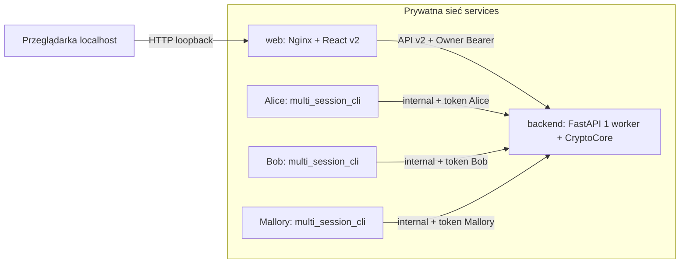

# Lokalne wdrożenie wielosesyjne — #87

Stan kodu: gałąź bazowa origin/feat/70-multi-session-ui, 5ca0454; zawiera #82,
#85 i #86. Integracja nie zmienia API ani kryptografii. **Publiczna beta NO-GO**:
nie dostarcza publicznego TLS, pełnego release gate ani niezależnego odbioru QA #71.
Kontrakt: [multi-session.md](multi-session.md), [STRIDE](../security/threat-model.md),
[gate](../security/release-gate.md), [wyniki](verification.md).

## Skład i granice zaufania



Pięć usług pozostaje niezależnymi procesami. Ulotny wielosesyjny rejestr jest
w jednym backendzie; każdy węzeł ma własną ograniczoną mapę agentów. Nie ma
procesu per użytkownik, bazy, Redis ani WebSocketów. Frontend ma tylko token
właściciela swojej sesji (sessionStorage), nigdy poświadczenia ról.

Publiczny port: wyłącznie 127.0.0.1:${RADH_HTTP_PORT:-8080}. Backend 8000 nie
jest publikowany. Sieć services ma internal=true. Web jest też w edge, ale nie
ma NET_ADMIN ani funkcji routera. Podsiec services domyślnie 172.30.87.0/24,
web ma stały adres 172.30.87.10. Uvicorn z --proxy-headers ufa wyłącznie temu
adresowi przez FORWARDED_ALLOW_IPS. Nginx nadpisuje XFF/Proto; nagłówki od innych
węzłów nie są zaufane. Przy zmianie podsieci ustawić spójnie RADH_SERVICES_SUBNET
i RADH_PROXY_IP, unikając konfliktu z VPN i innymi sieciami Dockera.

Allowlista proxy: GET nodes, POST create, GET/DELETE session, POST start/cancel,
GET events/diagnostics/diagnostics/mallory. ID ma dokładnie 32 małe hex.
Internal, stare sesje/heartbeat v1, /current, publikacja/ACK/forward i zapisy K
są niedostępne publicznie. Nieznane API daje 404, niedozwolona metoda znanej
trasy 403 (TRACE może być odrzucone wcześniej przez Nginx jako 405).
RSA/keygen/demo DH zachowują wyłącznie dotychczasowe POST pod /api/v1/.
Docs/OpenAPI/ReDoc są blokowane. Limiter proxy 20 r/s/IP, burst 20 (demo burst 5),
body 4 KiB, timeouty i security headers pozostają. Limity backendu nie są podnoszone.
Authorization, Idempotency-Key i epoch przechodzą do backendu; odpowiedzi zachowują
Retry-After i epoch, API i błędy proxy mają no-store. Nie logujemy URI/body/headerów.

## Sekrety i Fedora Linux

Wymagany rootful Docker bez userns-remap. Skrypt inicjalizacji wymaga sudo, aby
ustawić UID/GID 10001. Nie polegamy na uid/gid/mode w deklaracji Compose secrets:
file-based secrets są mountami plików hosta, a ich deklaracja nie naprawia praw.
Używamy jawnych read-only bindów z create_host_path=false. Brak pliku blokuje
start zamiast utworzyć pusty katalog. Inicjalizator na hoście z SELinux jawnie
wywołuje chcon dla trzech plików: typ container_file_t, współdzielony zakres s0.
Backend i właściwy węzeł czytają ten sam plik, więc nie nadajemy prywatnych
kategorii pojedynczego kontenera. Nie zmieniamy praw 0400 ani polityki SELinux.

Uwaga potwierdzona w Compose 5.6: create_host_path=false wybiera Mount API,
a buildBindOption nie przekazuje relabelowania. Pole selinux:z pozostaje w
konfiguracji, lecz samo nie gwarantuje etykiety. Źródło:
[implementacja Compose 5.6](https://github.com/docker/compose/blob/v5.6.0/pkg/compose/create.go).
Po odtworzeniu etykiet hosta przez restorecon ponownie uruchom inicjalizator;
chcon nie tworzy trwałej reguły fcontext. Zmiana jest ograniczona do trzech plików,
nie do katalogu projektu lub katalogu domowego.

```sh
# Z katalogu repozytorium:
test -f .env || cp .env.example .env
sudo python3 deploy/init_secrets.py
sudo docker compose config --quiet
sudo docker compose build
sudo docker compose run --rm --no-deps web -t
sudo docker compose up -d --wait
sudo docker compose ps
```

Katalog .local/secrets ma root:root 0700, każdy plik 10001:10001 0400.
Tokeny generuje secrets.token_urlsafe(32), trzy niezależne; inicjalizator nie
nadpisuje istniejących i odrzuca symlinki oraz nieprawidłowe prawa. Katalog jest
ignorowany przez Git i build context. Nie umieszczać tokenów w .env, ARG, ENV
obrazu ani argumentach procesu. Backend montuje wszystkie trzy pliki, węzeł
wyłącznie swój; web nie ma żadnych mountów/zmiennych poświadczeń.
Zmiana tokenów wymaga kontrolowanego restartu backendu i węzłów (sesje giną).
Rotacja bez przestoju pozostaje osobną bramką G13, poza #87.

Po starcie sonda każdej usługi runtime weryfikuje UID/GID/0400, możliwość
odczytu i flagę read-only rzeczywiście zamontowanych plików przez statvfs.
Backend dodatkowo odpytuje /internal/health/ready (koordynator + załadowanie C),
węzeł kontroluje proces PID 1/rolę i GET /api/v2/dh/nodes, bez heartbeatów sondy.
Web zachowuje /healthz. Runtime non-root/read-only/tmpfs, cap_drop ALL,
no-new-privileges, CPU/RAM/PID oraz rotowane logi pozostają w Compose.

## Diagnostyka, test i lifecycle

```sh
python3 deploy/smoke.py
# Po zmianie portu w .env, np. 18080:
python3 deploy/smoke.py --url http://127.0.0.1:18080
# Osobna próba z raportowaniem K przez węzły:
RADH_DIAGNOSTICS=1 sudo --preserve-env=RADH_DIAGNOSTICS docker compose up -d --wait
python3 deploy/smoke.py --diagnostics
sudo docker compose up -d --wait  # powrót do wartości .env
sudo docker compose logs --tail=100 web backend alice bob mallory
sudo docker compose stop
sudo docker compose start
sudo docker compose down
```

UI dodatkowo wymaga opt-in właściciela sesji. Smoke świadomie tworzy sesje
z opt-in właściciela także przy wyłączonych węzłach, aby sprawdzić brak K.
Respektuje Retry-After, więc idempotentne create może czekać na limiter; nie
wyłącza limitów. Sprząta własne sesje w finally; w razie niedostępności backendu
pozostaje TTL i komunikat błędu cleanupu. Równoległe starty i rzeczywiście
zaobserwowane nakładanie running są raportowane oddzielnie. Nie drukuje K/tokenów.

SIGTERM przechodzi przez exec do multi_session_cli. Restart backendu zmienia
epoch i usuwa ulotne rekordy; agent unieważnia stare dane i rejestruje się ponownie.
Po utracie lease proces kończy się, a unless-stopped uruchamia nową instancję.
Użytkownik musi utworzyć nowe sesje. Healthcheck unhealthy nie jest automatycznym
restartem zawieszonego procesu. Test restartu i brak starych sekretów wymagają
odbioru runtime, nie są dowiedzione samą konfiguracją.

Aktualizacja: zbudować obrazy z jednego SHA, wykonać smoke i kontrolowanie
odtworzyć komplet. Zachować tagi poprzednich runtime/web do rollbacku całego
zestawu; sesje nie przeżywają wdrożenia. Jeden backend z pamięcią oznacza brak
skalowania poziomego, HA i trwałości. Monitoring/alerty, TLS/domena, digesty/SBOM,
skany CVE i poufny kanał zgłoszeń nadal wymagają release gate. Edukacyjne RSA/DH
32-bitowe nie chronią prawdziwych danych.

## Ograniczenia i historia

Compose v1 z #73 było lokalnym środowiskiem przejściowym. Instrukcje dopuszczania
/current w tamtej wersji są historyczne i nie dotyczą #87. Wersje bazowych obrazów
pozostają przypięte jak w #73; nie aktualizowano zależności ani ABI dla integracji.
Rootless/userns-remap wymaga osobnego mapowania UID i testów mountów. Nie deklarujemy
weryfikacji SELinux, restartów, sygnałów ani pięciu healthy bez rzeczywistego Dockera.


Rozbieżność ujawniona podczas integracji: #69 wysyła skrócone
remaining_ttl_seconds dla completed, ale #68 w tym stanie nadal utrzymuje lokalne
okno 30 s od pierwszej obserwacji. Backend odrzuca raport po swoim deadline;
lokalny agent może pozostać dłużej o opóźnienie discovery. Nie zmieniono transportu
w #87; poprawkę retencji należy uzgodnić z właścicielem #68 przed odbiorem gate.

## Docelowy VPS — plan #73 poza lokalną integracją #87

Jedna maszyna Linux, początkowo 2 vCPU/4 GiB RAM, bez Kubernetesa i bez bazy.
Nginx (lub równoważny pojedynczy proxy) serwuje dist i kończy TLS 1.2/1.3.
Certyfikat ACME odnawiany przez operatora/systemd, sprawdzenie ważności i próbne
odnowienie; klucz TLS tylko w chronionym pliku, montowany read-only. Hostname
jawnie dopuszczony. 443 publiczne; 80 wyłącznie redirect/ACME, SSH tylko z adresów
administratora. Nigdy nie publikować 8000, 8080 wewnętrznego, panelu Docker ani metryk.
Po sprawdzeniu HTTPS włączyć HSTS; nie na lokalnym HTTP.

Backend pozostaje jednym procesem z chronionym publicznym routerem v2 i
wewnętrznym routerem z tokenami ról. Publiczny proxy ma allowlistę v2 oraz RSA,
blokuje legacy sesje v1, `/internal`, docs i schema. Forwarded headers są
nadpisywane przez proxy, a backend ufa wyłącznie konkretnemu adresowi/CIDR proxy.
Nie ufać `X-Forwarded-For` z Internetu ani stosować `forwarded-allow-ips=*` bez
izolacji listenera. Lokalny Compose #87 ufa wyłącznie skonfigurowanemu IP web; ustawienia
TLS i publicznego listenera wymagają oddzielnego wdrożenia oraz odbioru gate.

### Sekrety, zasoby, logi

Tokeny ról generuje operator (`secrets.token_urlsafe(32)`), trzy niezależne pliki
z dostępem tylko dla odpowiedniego UID; backend dostaje ich skróty lub prywatne
pliki konfiguracyjne. Bez ARG/ENV podczas builda, obrazu, frontendu i Git.
Ścieżki `_FILE` są obsługiwane przez #68/#69 i montowane w lokalnym Compose #87.
W Sprincie A dopuszczamy wymianę tokenów ról z zatrzymaniem/restartem usług
oraz fencing; rotacja bez przestoju z maks. 60 s nakładania tokenów to follow-up
operacyjny obowiązkowy przed publikacją (G13), poza implementacją #68–71.
Owner tokeny powstają na serwerze w #69 i są ograniczone do życia sesji.
Hasło do TLS/ACME, token roli i prywatny wykładnik edukacyjny to różne aktywa.

Limity początkowe kontenerów: backend 1 CPU/512 MiB/64 PID, każdy węzeł
0,5 CPU/256 MiB/64 PID, proxy 0,5 CPU/128 MiB/32 PID; 16 MiB tmpfs/usługę.
To górne limity, nie rezerwacje, suma może przewyższać 2 vCPU — wymagany pomiar
sprawiedliwości pod obciążeniem. Limity backendu sesji/żądania z multi-session
są konieczne niezależnie od cgroups. Kernel OOM może zabić proces i utracić sesje.

- Monitorować: 5xx/429, p95 latency, CPU/RSS/PID, liczbę sesji i węzłów,
  rozmiar cache/tombstone, wygaśnięcia, brak heartbeat >10 s, restarty/OOM,
  ważność TLS i miejsce na logi. Metryki bez etykiet session_id/token/IP.
- Docelowy prywatny `/internal/metrics` (osobne PBI operacyjne) lub mały hostowy
  collector; brak Prometheusa nie może oznaczać braku alarmów. Do bety wystarczy
  chroniony monitoring hosta i syntetyczne sondy. W #73 nie dodano endpointu metrics.
- Alarmy początkowe: >1% 5xx przez 5 min, p95>2 s przez 5 min, RSS>80% limitu
  przez 5 min, rola offline>30 s, dysk>80%, certyfikat<14 dni. Dostosować po pomiarze.
- Logi strukturalne: UTC, request_id wygenerowany/zwalidowany przez serwer,
  kod operacji/status/latency, pseudonim sesji z okresowo rotowanym kluczem;
  bez Authorization, Idempotency-Key, body, query, K i wykładników. Retencja
  docelowo 7 dni, dostęp operatora, kasowanie. Nginx access log w Compose nie
  zapisuje URI ani adresów IP; błędy proxy mogą zawierać kontekst żądania — przed
  publikacją przetestować redakcję również error logów i APM.
- Wyłączenie uwierzytelniania nie jest opcją produkcyjną. Nie używać sztucznych
  heartbeatów do „naprawienia” zielonego statusu usług.

## Aktualizacja, rollback i skalowanie

1. QA uruchamia regresję, skan obrazów i smoke na lokalnym stagingu. Operator
   zapisuje SHA kodu, locki, digesty obrazów, konfigurację i wynik release gate.
2. Włącza komunikat konserwacji, blokuje nowe sesje, czeka maks. 600 s na aktywne
   lub je jawnie anuluje. Pojedynczy backend oznacza krótkie okno niedostępności.
3. Buduje obrazy z wersjonowanym `RADH_IMAGE_TAG` (np. SHA), zachowuje poprzednie
   obrazy; nie nadpisuje jedynej znanej dobrej wersji. Zmiany #68–71 wdraża atomowo.
4. Aktualizuje spójny zestaw web/backend/3 role, sprawdza sondy i normal/MITM/RSA.
   Zmieniony backend oznacza nowy epoch i brak poprzednich rekordów/tokenów.
5. Przy regresji przywraca poprzednie **obrazy i konfigurację całego zestawu**,
   ponownie startuje usługi. To nie przywraca pamięci sesji ani wykładników.
   Informuje użytkowników o konieczności nowej sesji.

Na dziś deploy/rollback polega na lokalnym `docker compose up -d --build` lub
odtworzeniu zapisanego zestawu obrazów; brak automatycznej publikacji i zero-downtime.
Nie zwiększać liczby workerów/replik backendu i nie stosować round-robin między
oddzielnymi rejestrami. Nie skalować ról węzłów przez `--scale`: jeden lease/rola.
Dalsze skalowanie wymaga osobnego PBI: wspólny store/koordynacja, przydział ról,
fencing i przeprojektowanie trwałości; samo dodanie Redis nie przenosi sekretów węzłów.

## Źródła decyzji

- [Docker Compose: sieci](https://docs.docker.com/compose/how-tos/networking/) — nazwy usług, izolacja i publikowanie portów.
- [Compose services](https://docs.docker.com/reference/compose-file/services/) — healthcheck, read_only, limity i restart.
- [OWASP REST Security](https://cheatsheetseries.owasp.org/cheatsheets/REST_Security_Cheat_Sheet.html) — rozdzielenie auth i URL, ograniczenie treści błędów.

Rzeczywiste wykonanie w środowisku autora opisuje [verification.md](verification.md).
Żaden diagram ani healthcheck nie dowodzi dopuszczenia do Internetu.


## Demo LAN

`compose.lan.yaml` jest jawnym nakładanym wariantem dla prezentacji kilku
użytkowników w jednej zaufanej sieci Wi-Fi. Wymaga RADH_LAN_IP, np. 192.168.1.30.
Używa wyłącznie konkretnego IP hosta oraz 127.0.0.1, nie wildcard 0.0.0.0.
Backend pozostaje nieopublikowany; role, pliki tokenów, allowlista, limity i
hardening są takie same jak lokalnie. Origin zawiera oba localhost/127.0.0.1
oraz dokładny adres LAN z RADH_HTTP_PORT. Nie włączamy wildcard CORS.

```sh
sudo env RADH_LAN_IP=192.168.1.30 docker compose -f compose.yaml -f compose.lan.yaml config --quiet
sudo env RADH_LAN_IP=192.168.1.30 docker compose -f compose.yaml -f compose.lan.yaml up -d --wait
# Powrót do samego loopback:
sudo docker compose -f compose.yaml up -d --wait
```

Nakładka używa !override dla dokładnej listy portów; wymaga Compose 2.24.4+
([dokumentacja Docker](https://docs.docker.com/reference/compose-file/merge/)).
Zmiana Origin odtwarza backend i gubi ulotne sesje. Wystarczą istniejące obrazy,
bez zmiany frontendu. Klucze tworzenia UI używają getRandomValues, dostępnego
również poza secure context
([dokumentacja API](https://developer.mozilla.org/en-US/docs/Web/API/Crypto/getRandomValues));
nie korzystają z wymagających HTTPS subtle/randomUUID. Działania prawdziwego
Safari i sieci Wi-Fi trzeba potwierdzić na telefonie, nie testem konfiguracji.

Telefon wchodzi pod http://IP_KOMPUTERA:PORT, komputer może korzystać z localhost.
Różne urządzenia mają niezależne sessionStorage i sesje. Zmiana/reset jednego
nie powinna zmieniać drugiego. Demo w HTTP w zaufanej LAN nie jest publicznym
wdrożeniem ani spełnieniem gate TLS; nie konfigurować przekierowania routera.
