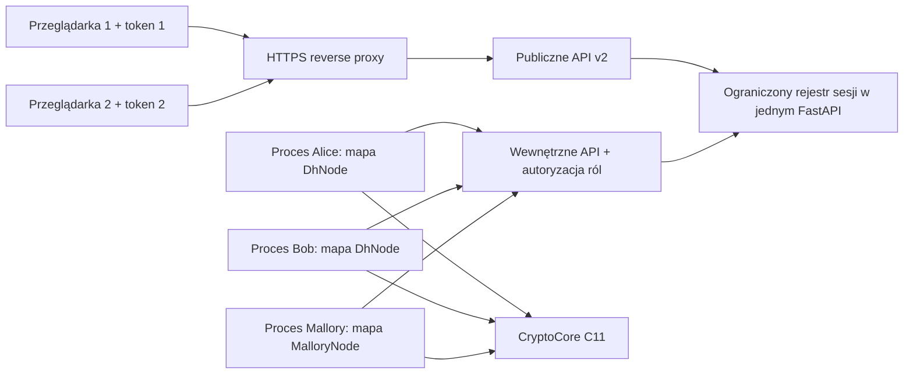
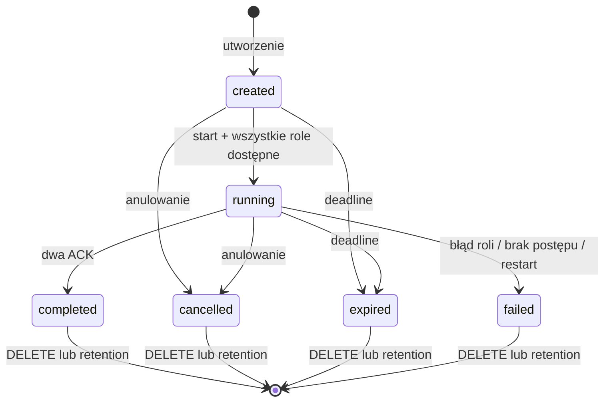
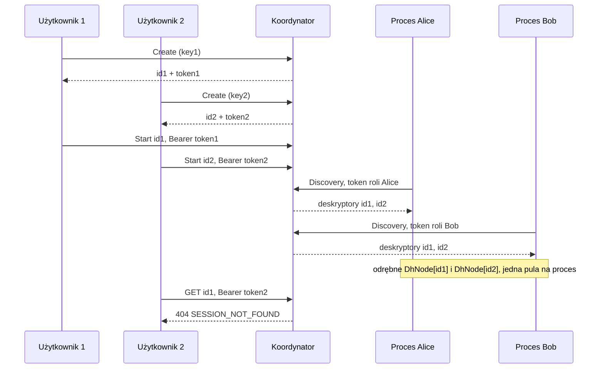
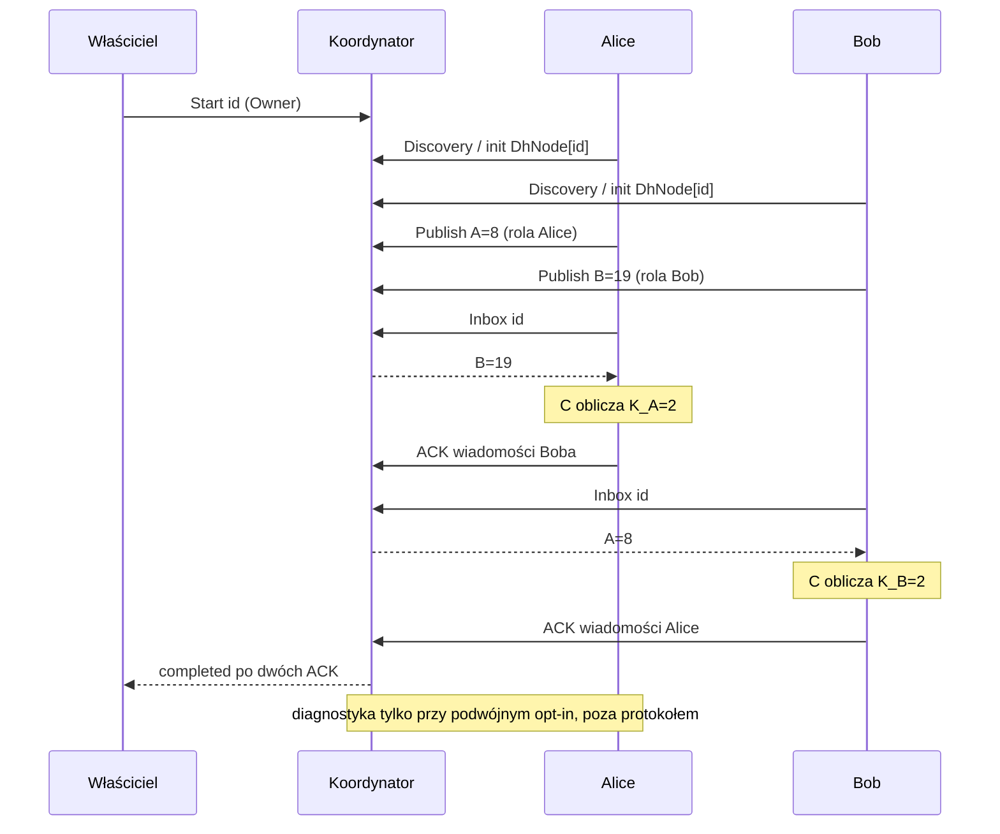

# Kontrakt wielosesyjności RADH — #73

**Wersja 1, 2026-11-17. Status: specyfikacja do uzgodnienia z właścicielami #68–71.**
Normatywne „musi” opisuje wymaganie implementacyjne, nie istniejącą funkcję.
Podstawa audytu: `main` a37d066. Ten dokument nie wdraża API v2.

## 1. Wynik audytu i granica zmiany

| Obszar | Stan potwierdzony w kodzie | Konsekwencja |
| --- | --- | --- |
| `backend/app/sessions.py` | `SessionStore.session` jest pojedynczym obiektem, `used_ids` stale rośnie; jeden `RLock` | Globalna sesja, brak limitu pamięci historii ID |
| `backend/app/main.py` | Magazyny tworzone w `app.state` przy imporcie, brak autoryzacji, middleware limitów i cleanupu | Nie udostępniać obecnego backendu publicznie |
| `backend/app/session_models.py` | UUID domyślny, ale klient może narzucić ID; ścisłe uint32 i `extra=forbid` | Walidacja nie stanowi kontroli dostępu |
| `backend/dh_transport.py` | Polling `/current` co 0,5 s, jeden `node`, jeden `_diagnostics_sent`; heartbeat co 1 s, timeout 2 s | Proces zna tylko jedną sesję; brak uwierzytelnienia roli |
| `backend/app/node_presence.py` | TTL 5 s, role z URL, bez poświadczeń i identyfikacji uruchomienia procesu | Każdy klient API może podszyć się pod węzeł |
| `nodes/node.py`, `nodes/mallory.py` | Jeden stan na instancję; lokalne losowanie `secrets`; Mallory składa dwa `DhNode`; atomowy start | Zachować klasy, dodać ograniczony rejestr instancji per sesja w procesie |
| `frontend/src/api.ts`, `DhExchange.tsx` | Brak tokenów; ID w stanie widoku; polling 1 s/3 s; `requestId` chroni UI przed starymi odpowiedziami | Dodać autoryzację i rozdzielenie stanów sesji, zachować ochronę odpowiedzi |
| `crypto-core/`, `backend/app/crypto_core.py` | C11, uint32, mnożenie uint64, jawne statusy, zapis po sukcesie; ctypes waliduje liczby przed konwersją | Zachować algorytmy, ABI i kolejność walidacji |
| Diagnostyka | Osobne endpointy K, zapis po ACK/forward, lokalna flaga `--allow-diagnostics`; odczyty bez autoryzacji | Oddzielenie od protokołu istnieje, kontrola dostępu nie istnieje |
| Testy i CI | CTest, pytest, testy procesowe HTTP, build/lint React; brak testów izolacji użytkowników, limitów i ról | Zakres nowych dowodów: #71; workflow pozostaje bez zmian w #73 |

Cel: jeden backend, jeden proces każdej roli, wiele logicznych sesji. Bez Redis,
bazy, kont, WebSocketów i procesu OS per użytkownik. RSA/keygen są bezstanowe.
Wydzielenie repozytorium sesji i zabezpieczenia HTTP nie zmienia kryptografii.
Obecny Compose opisany w [deployment.md](deployment.md) uruchamia wyłącznie stan v1.



### Zakres realizacji i kolejność odbioru

| Etap | Wymagania i granica zakresu |
| --- | --- |
| **Obowiązkowe w Sprincie A (#68–71)** | Ograniczone rejestry sesji i agentów, izolacja danych/K/logów, Owner Bearer, uwierzytelnianie i uprawnienia ról, epoch/instance fencing, discovery, TTL/cleanup/tombstones, bounded retry i idempotencja, limity zasobów/żądań/C, obsługa restartów i zmian w UI. Testy funkcjonalne obejmują macierze auth, równoległość, zegar, limity i regresję. Podstawowe odwołanie tokenu roli przez zatrzymanie usług, zmianę plików i kontrolowany restart jest wymagane. |
| **Przed publiczną publikacją, także w kolejnych sprintach** | Cały release gate G01–G25: TLS i firewall, provisioning sekretów, skany/digesty, monitoring i alarmy, runbook/rollback, poufne zgłoszenia oraz pomiary obciążenia/retencji na docelowym VPS. Rotacja tokenów ról bez przerywania usług z maks. 60 s nakładania tokenów to osobny follow-up operacyjny (G13), nie warunek ukończenia #68–71. Do jego odbioru publikacja pozostaje NO-GO. |
| **Przyszłe rozszerzenia operacyjne** | Trwałe sesje, HA i skalowanie poziome, scentralizowane dashboardy/logi oraz transport między hostami z mTLS. Nie są wymagane dla pierwszej bety na jednym VPS; nie zastępują podstawowego monitoringu i logów wymaganych przez gate. |

Realizacja #68–71 nie oznacza zgody na publikację. W #71 obowiązkowe są testy
izolacji, auth, fencing, TTL, idempotencji i rzeczywistych limitów; końcowy odbiór
obciążenia G21/G22 i infrastruktury wymaga gotowego stagingu oraz udziału operatora.
Wymagania opisane dalej dotyczą docelowej bety; jedynym odroczonym mechanizmem
w kontrakcie usług jest wskazana wyżej rotacja bez przestoju. Nie odraczamy auth,
odwołania uprawnień, fencing, TTL ani ograniczeń zasobów.

## 2. Tożsamość, autoryzacja i izolacja

### Właściciel sesji bez konta

- Serwer generuje `session_id = uuid4().hex` (32 małe znaki hex); klient nie
  wysyła ID. Sprawdzenie kolizji obejmuje aktualny rejestr i ograniczone tombstones.
- Niezależnie losuje `session_token = secrets.token_urlsafe(32)` (256 bitów entropii).
  ID jest publicznym adresem obiektu; **znajomość ID nie uprawnia do odczytu**.
- Token jest capability pełnego dostępu właściciela do jednej sesji: odczyt,
  start, anulowanie, usunięcie oraz odczyt jej diagnostyki. Brak listy sesji użytkowników.
- Po utworzeniu token wraca tylko w odpowiedzi `201`, nigdy w SessionView,
  zdarzeniach, URL, logach, komunikatach węzłów ani metrykach.
  Serwer przechowuje SHA-256 tokenu, porównuje stałoczasowo przez `compare_digest`.
- Przeglądarka wysyła `Authorization: Bearer <session_token>` na każdy odczyt
  i zapis sesji. W pamięci/sessionStorage przechowuje parę ID/token per karta;
  nie w localStorage, historii, querystring ani fragmentach linków.
  Utrata tokenu oznacza brak odzyskiwania; sesja sama wygaśnie. To świadomy koszt braku kont.
- Brak cookies uwierzytelniających. JSON i własny nagłówek Authorization ograniczają
  klasyczne CSRF, lecz nie XSS. Ten sam origin, bez wildcard CORS; serwer odrzuca
  obcy Origin (403 `ORIGIN_NOT_ALLOWED`). Narzędzia CLI bez Origin są dozwolone
  przy poprawnym Bearer. Origin nie zastępuje tokenu. Wszystkie odpowiedzi API:
  `Cache-Control: no-store`; nagłówki i treść nigdy nie trafiają do access logów.
- Brak lub zły format Bearer: 401 `UNAUTHORIZED` z `WWW-Authenticate: Bearer`.
  Nieznane ID lub błędny token przy poprawnym formacie: ta sama odpowiedź
  404 `SESSION_NOT_FOUND`. Usunięty rekord z zachowanym tombstone i poprawnym tokenem: 410
  `SESSION_EXPIRED`. Nie umożliwiać odróżnienia cudzej sesji od nieistniejącej,
  również gdy istnieje tombstone. Najpierw sprawdzić uprawnienie; kod 410 nie jest
  ujawniany osobie z błędnym tokenem o poprawnym formacie.

Odczyt `GET /api/v2/dh/sessions/{id}` z prawidłowym tokenem:

| Stan danych | HTTP / wynik |
| --- | --- |
| Istniejąca aktywna sesja (created/running) | 200 SessionView |
| Istniejąca zakończona sesja (completed/cancelled/failed) | 200 SessionView |
| Istniejąca expired podczas retencji | 200 SessionView, bez K; diagnostyka zwraca wyłącznie null |
| Usunięty rekord, zachowany tombstone | 410 SESSION_EXPIRED |
| Brak rekordu i tombstone | 404 SESSION_NOT_FOUND |

Historia istniejącej expired pozostaje czytelna (200) do końca retencji. K jest
kasowane przy wygaśnięciu, także w agentach. Start, cancel oraz wszystkie zapisy
protokołu/diagnostyki do expired dają 409 `INVALID_SESSION_STATE`, bez zmiany
stanu, także przy identycznym retry. **Wyjątek: właściciel może DELETE expired**
(204), usuwając rekord i pozostawiając tombstone. Te reguły nie przedłużają TTL.

### Tworzenie i jego ponowienie

`POST /api/v2/dh/sessions` nie wymaga konta ani istniejącego tokenu. Wymaga
`Idempotency-Key`: losowe base64url 32 bajtów, generowane przez Web Crypto.
Ten nagłówek jest **tymczasowym poświadczeniem**, nie numerem sesji.
Przed wysłaniem UI zapisuje klucz i treść próby w sessionStorage. Serwer trzyma
ograniczony cache odpowiedzi tworzenia przez 60 s (maks. 128 wpisów), w tym token
potrzebny do powtórnego zwrócenia odpowiedzi. Cache jest jedynym krótkotrwałym
wyjątkiem od przechowywania wyłącznie skrótu tokenu. Sekretów nie logować.

Każda odpowiedź v2 i internal, także błąd, zawiera `X-Backend-Epoch`.
UI odczytuje go z publicznego GET `/api/v2/dh/nodes` przed tworzeniem i wysyła
jako wymagany nagłówek `X-Backend-Epoch` POST create. Brak nagłówka daje 400
`BAD_REQUEST`, niezgodny epoch daje 409 `BACKEND_EPOCH_MISMATCH` przed tworzeniem.
To blokuje odtworzenie niepotwierdzonej próby na nowym backendzie, także gdy
restart nastąpi między sprawdzeniem dostępności a POST. Epoch nie jest sekretem.

Ten sam klucz i znormalizowane parametry zwracają to samo `201` i ten sam token
bez nowej sesji; zmieniona treść daje 409 `IDEMPOTENCY_CONFLICT`. Po wyczerpaniu
cache odrzucić nowe tworzenie 503, nie usuwać świeżego wpisu potrzebnego do retry.
Po wygaśnięciu cache hash klucza pozostaje w rekordzie; ta sama próba daje
409 `CREATE_RETRY_EXPIRED`, a nie nowy obiekt. Po 60 s klient **nie ponawia automatycznie** niepotwierdzonego tworzenia; wyświetla
informację o utraconej próbie i może rozpocząć jawną nową próbę z nowym kluczem.
Osierocony obiekt usuwa TTL. Restart backendu unieważnia cache — analogicznie brak
automatycznych ponowień tworzenia po wykryciu restartu. Nie obiecywać exactly-once
po utracie pamięci. Błędny/sprzeczny klucz nie tworzy obiektu.

Każde żądanie tworzenia, w tym retry z tym samym Idempotency-Key i trafienie
w cache, przechodzi limiter **6 żądań/min/IP, burst 2 przed odczytem cache**
i kosztowną walidacją. Klucz nie zmienia bucketa IP i nie omija limitów.
429 `RATE_LIMITED` z Retry-After nie tworzy sesji ani nowego tokenu; zaakceptowane
retry w oknie 60 s zwraca to samo ID/token. Oczekiwanie na limiter nie przedłuża
cache; po 60 s nadal obowiązuje CREATE_RETRY_EXPIRED, bez automatycznego restartu próby.

Test G05 wykonuje 100 ponowień w czasie <60 s na izolowanej konfiguracji testowej,
np. create 6000/min/IP, burst 128 (także na testowym proxy), bez zmiany TTL cache.
Sprawdza jedną sesję i identyczne ID/token wszystkich zaakceptowanych odpowiedzi.
Osobny test integracyjny z **domyślnymi** limitami 6/min/IP, burst 2 sprawdza
429 i Retry-After, również dla trafień w cache, oraz identyczność ID/token
zaakceptowanych ponowień. Artefakt testu zapisuje efektywne limity; konfiguracja
G05 nie trafia do bety i nie osłabia domyślnych zabezpieczeń.

### Tożsamość usług i uruchomień procesów

- Osobny losowy token usługowy 256 bitów dla Alice, Boba i Mallory, ładowany
  przez pliki sekretów poza repozytorium; np. `RADH_ALICE_TOKEN_FILE`.
  Backend posiada konfigurację skrótów i przypisanie token → dokładna rola.
- Wewnętrzny Bearer nie działa jako token właściciela i odwrotnie. Sprawdzenie
  następuje **przed** operacją na sesji. Brak/błędny token: 401; próba innej roli:
  403 `ROLE_FORBIDDEN`. Dane `sender`/`participant` nie są źródłem uprawnień.
- Każdy start backendu ma nowe losowe `backend_epoch` (UUID hex). Każdy start
  procesu węzła ma nowe `instance_id` (UUID hex). Heartbeat rejestruje instancję
  roli i zwraca epoch. Nie przekazuje sekretów DH ani tokenów użytkowników.
- Tylko jedna żywa instancja danej roli: nowy `instance_id`, gdy poprzedni ma
  świeży heartbeat, dostaje 409 `NODE_INSTANCE_CONFLICT`. Operator zatrzymuje
  duplikat lub czeka na wygaśnięcie lease; nie przejmować aktywnej roli po cichu.
- Wewnętrzne żądania poza heartbeat mają nagłówki `X-Backend-Epoch` i
  `X-Node-Instance`. Zły epoch: 409 `BACKEND_EPOCH_MISMATCH`; niezarejestrowana
  instancja: 409 `NODE_INSTANCE_MISMATCH`.
- Sprint A: odwołanie tokenu i wymiana plików z kontrolowanym zatrzymaniem/restartem
  usług; restart wymusza nowe instance_id/epoch i kończy dotknięte sesje zgodnie
  z fencing. Follow-up przed publikacją (G13): rotacja bez przestoju nie zmienia
  instance_id; stare/nowe tokeny jednej roli nakładają się maks. 60 s, potem stary
  jest odwołany. Nie wymagać implementacji gorącego przeładowania tokenów w #68–71.
- Proxy publiczne nigdy nie przekazuje `/internal/`. Prywatna sieć jest dodatkową
  granicą, nie zamiennikiem autoryzacji. Na jednym VPS HTTP wewnętrzne jest dopuszczone
  jako zaakceptowane ryzyko; na wielu hostach wymagane TLS/mTLS (poza pierwszą betą).

## 3. Model danych i współbieżność

Rejestr `sessions: dict[session_id, SessionRecord]` zawiera najwyżej 128 obiektów,
nie pojedynczy `current`. W rekordzie: ID, skrót tokenu, skrót klucza tworzenia, epoch, `prime`, `generator`,
`mode`, `diagnostics_enabled`, stan, powód zakończenia, UTC timestamps,
monotoniczne deadline'y, `revision`, blokada per sesja, przypisane instance_id,
klucz limitu IP twórcy (HMAC z normalizowanego IP, klucz efemeryczny backendu),
postęp obu uczestników, maks. dwie wiadomości, dwa przechwycenia, 32 zdarzenia,
osobny obiekt diagnostyki i deadline retry diagnostyki. `p/q` RSA nie należą do sesji DH.

Koordynator przekazuje publiczne wiadomości i weryfikuje stan/role; nie generuje
wykładników a/b/x/y i nie wywołuje centralnego DH. Opcjonalne K przechowuje
oddzielnie tylko na jawne życzenie właściciela i przy lokalnym opt-in węzła.
Nie sprawdza prawdziwości K ani równości kluczy przy oznaczaniu `completed`.

Rejestr ma krótką blokadę do przydziału/zwalniania i limitów; operacje stanu mają
blokady per sesja. Kolejność blokad: rejestr → sesja; nigdy odwrotnie. Nie trzymać
blokad podczas sieci i CryptoCore. Walidacja, sprawdzenie duplikatu i commit
mutacji jednej sesji są atomowe; snapshot jest kopią, nie referencją do mutowalnego stanu.

Zdarzenie zachowuje istniejące pola `sequence,type,sender,recipient,public_value,
message_id,status`, dodaje UTC `created_at`; numeracja jest osobna dla sesji od 1.
Nowe typy: `session_failed`, `session_expired`. Żadne nie zawiera K/tokenów/wykładników.
Nie logować odrzuconej dowolnej treści; retry nie dopisuje nowego zdarzenia.
Przekroczenie 32 zdarzeń to 409 `EVENT_LIMIT_REACHED` bez częściowego zapisu,
a nie ciche obcięcie dowodu przebiegu. Logi operacyjne i zdarzenia edukacyjne są osobne.

### Rejestry w procesach (#68)

Każdy proces posiada ograniczone `agents[(backend_epoch, session_id)]`:
Alice/Bob → odrębny `DhNode`, Mallory → odrębny `MalloryNode` z własną parą sekretów.
Żadna instancja nie jest przekazywana do innej sesji. Transport trzyma również
per wpis stan publikacji, ACK i diagnostyki — nie globalne `_diagnostics_sent`.

Polling listy raz na sekundę (±20% jitter). Lista obejmuje wszystkie przypisane
rekordy (maks. 128), bez `/current` i bez tokenów właścicieli. Normalne sesje nie
są przypisywane Mallory. Na start koordynator przypina aktualne instance_id
Alice/Boba, a dla MITM także Mallory. Brak dowolnej wymaganej roli → 409
`NODE_UNAVAILABLE`, sesja zostaje `created`. Jedna operacja na daną instancję
agenta naraz, pozostałe sesje obsługiwane sprawiedliwie round-robin. Pula max.
2 zadań w procesie; osobny heartbeat nie dotyka agentów. Brak wątku per sesja.
Osiągnięcie lokalnej pojemności → zgłoszenie `NODE_CAPACITY` i failure sesji,
bez nadpisania innego wpisu.

Przed obliczeniem/ACK sprawdzić ID, epoch i instance_id; przed zapisem wyniku
ponownie sprawdzić, czy wpis wciąż jest aktualny i nieanulowany. Anulowanie
podczas ctypes nie przerywa C w połowie — wynik odrzucić po powrocie.
Po zniknięciu deskryptora / 404 / 410 / terminalnym stanie usunąć agenta i wyniki.
Dla completed wolno zachować istniejącego agenta max. 30 s na retry diagnostyki;
nie tworzyć nowego agenta z ukończonego deskryptora. Zmiana epoch usuwa całą mapę.

## 4. Retry, błędy i cykl życia

- Wiadomość ma deterministyczne ID `alice-public` albo `bob-public`, unikalne
  **wewnątrz sesji**. Źródło/odbiorca są wyznaczane z uwierzytelnionej roli.
- Publikacja tej samej treści i ID, identyczny forward oraz ACK są idempotentne,
  także po completed. Inna treść → 409 `MESSAGE_ID_CONFLICT`, inna podmiana →
  409 `REPLACEMENT_CONFLICT`. Diagnostyka identyczna → 204, inna → 409
  `DIAGNOSTIC_CONFLICT`. Retry nie losuje nowych sekretów.
- ACK dopiero po lokalnym sukcesie C; forward Mallory dopiero po właściwym
  obliczeniu. Wynik błędu C nie nadpisuje poprzedniego. Dane błędu nie zawierają argumentów.
- Spóźniony zapis do cancelled/expired/failed nie zmienia stanu, daje 409
  `INVALID_SESSION_STATE`; po usunięciu obiektu 410/404 zgodnie z autoryzacją.
  Wyjątkiem jest DELETE właściciela, dozwolone także dla expired podczas retencji.
- Timeout HTTP: 3 s connect / 5 s całość, retry z backoff 0,5/1/2/4/8 s,
  jitter ±20%, maks. 30 s bez kontaktu. 404/410 kończy pracę dla ID, 401/403
  zatrzymuje klienta roli i wymaga interwencji, 422 nie jest bezmyślnie ponawiane.
  429/503 respektuje `Retry-After` (maks. 30 s), bez nieskończonej kolejki.
- Brak postępu przez 30 s w running → `failed`, `failure_code=PARTICIPANT_TIMEOUT`.
  Postęp oznacza nową zaakceptowaną wiadomość/forward/ACK, nie odczyt ani retry.
- Wygasły heartbeat roli w aktywnej przypisanej sesji → `failed` z
  `NODE_UNAVAILABLE`. Nowa instancja roli nie odtwarza utraconych sekretów:
  sesje starej instancji → `failed`, `NODE_RESTARTED`; użytkownik tworzy nowe ID.
- Restart backendu gubi wszystkie sesje i tworzy epoch. UI na 404/410 czyści token
  tej sesji, zatrzymuje polling i proponuje nową. Przy 200 ze statusem expired
  usuwa K z widoku, zatrzymuje polling i blokuje start/cancel, lecz zachowuje
  ID/token na czas retencji, aby właściciel mógł DELETE. Token usuwa po skutecznym
  DELETE, 404/410 lub świadomym porzuceniu widoku. Nie odtwarzać automatycznie
  operacji z poprzedniego epoch. Utrata tajnych wykładników jest nieodwracalna.
- UI wiąże każdą odpowiedź z ID, epoch i lokalnym numerem żądania, używa
  AbortController/timeoutu. Zakończony stary request nie zmienia nowego widoku.



Start tego samego ID w running/completed zwraca 200 z aktualnym stanem bez nowego
startu; start w cancelled/expired/failed → 409. Anulowanie w cancelled jest
idempotentne; w completed/expired/failed → 409. DELETE jest dozwolone właścicielowi
we wszystkich istniejących stanach, również expired; anuluje aktywną sesję,
czyści wiadomości, log i K, zostawia ograniczony tombstone (hash tokenu i klucza tworzenia, ID,
epoch, przypisania ról/instancji, termin usunięcia). Ponowne DELETE z prawidłowym tokenem → 204, dopóki
istnieje tombstone, później 404. Przy usunięciu cache tworzenia danego obiektu
również jest kasowany; klucz tworzenia zapisany w tombstone daje
410 `CREATION_GONE`. Retry tworzenia nie może przywrócić usuniętej sesji.

## 5. Limity początkowe — do walidacji obciążeniowej, nie wyniki pomiarów

Wszystkie wartości poniżej są konfigurowalne; #69 waliduje je przy starcie.
Deadline'y liczone monotonicznie, daty odpowiedzi UTC RFC3339. Odczyt i polling
**nie przedłużają TTL**. Dla created `expires_at` jest minimum deadline
utworzenia (120 s) i absolutnego wieku; start zmienia go na deadline absolutny
(600 s od utworzenia). Dla terminalnych rekordów retencja liczy się od terminal_at,
nie od ostatniego odczytu. Hash tokenu umożliwia tylko dozwolone odczyty/usunięcie
do końca retencji; nie przywraca prawa do startu. Cleanup co 5 s oraz leniwie przed operacją; opóźnienie
cleanup nie pozwala użyć wygasłej sesji.

| Konfiguracja docelowa | Domyślnie | Znaczenie |
| --- | ---: | --- |
| `MAX_SESSIONS` / `MAX_RUNNING_SESSIONS` | 128 / 32 | Łącznie z created i terminalnymi / równocześnie running |
| `MAX_NODE_AGENTS` | 128 na rolę | Twardy limit wszystkich lokalnych instancji |
| `MAX_SESSIONS_PER_IP` | 8 | Created/running; proxy ustala IP, NAT współdzieli limit |
| `SESSION_CREATED_TTL_SECONDS` | 120 | Czas od utworzenia do startu |
| `SESSION_MAX_AGE_SECONDS` | 600 | Absolutny czas od utworzenia, również po starcie |
| `SESSION_RETENTION_SECONDS` | 300 od terminalizacji | Maks. czas odczytu ukończonego/anulowanego/failed/expired rekordu |
| `TOMBSTONE_TTL_SECONDS` / `MAX_TOMBSTONES` | 600 / 256 | Po usunięciu; najstarszy może być usunięty przy limicie → później 404 |
| `CREATE_RETRY_TTL_SECONDS` / `MAX_CREATE_RETRIES` | 60 / 128 | Cache idempotencji tworzenia |
| `MAX_EVENTS` / `MAX_MESSAGES` / `MAX_INTERCEPTIONS` | 32 / 2 / 2 per sesja | Stały rozmiar historii protokołu |
| `MAX_REQUEST_BYTES` / `MAX_RESPONSE_BYTES` | 4096 / 131072 | Proxy i backend; węzły ograniczają czytaną odpowiedź przed JSON |
| `NODE_HEARTBEAT_SECONDS` / `NODE_LEASE_SECONDS` | 2 / 10 | Po 10 s bez heartbeat rola offline |
| `NODE_DISCOVERY_SECONDS` / `UI_POLL_SECONDS` | 1 / 2 | Z jitter; jedna prośba w locie na dany zasób |
| `NODE_HTTP_CONCURRENCY` | 4 na rolę | Ograniczona pula, nie 128 równoległych odpytań |
| `DIAGNOSTICS_RETRY_SECONDS` | 30 po completed | Potem usunięcie lokalnego agenta |
| `MAX_CRYPTO_JOBS` / `MAX_CRYPTO_WAITERS` | 2 / 8 | W backendzie; pełna kolejka → 503 `CRYPTO_BUSY`, Retry-After 2 |
| Limiter RSA i legacy DH | 20/min/IP, burst 5 | Koszt C i walidacji pierwszości |
| Limiter create | 6/min/IP, burst 2 | Każde żądanie, także retry; przed cache i kosztowną walidacją p/g |
| Limiter publicznych odczytów | 120/min/token, 240/min/IP | Obsługuje polling stanu i diagnostyki co 2 s; osobne buckety |
| Limiter internal | 3000/min/rola, burst 128 | Discovery + maks. 32 sesje co 2 s; backoff przy braku postępu |
| `MAX_RATE_BUCKETS` / `RATE_BUCKET_TTL_SECONDS` | 4096 / 600 | Limitery również nie mogą tworzyć nieograniczonej mapy IP/tokenów |

Pełna pojemność globalna lub cache retry → 503 `SESSION_CAPACITY`, Retry-After 5;
limit running → 503 `RUNNING_CAPACITY`; limit IP/rate → 429 `RATE_LIMITED`,
Retry-After do końca okna. Nie usuwać aktywnej sesji innego użytkownika, by
obsłużyć nowego. W razie pełnej mapy limiterów stosować globalny wspólny bucket
zamiast przydzielać nieograniczoną pamięć. CPU/memory kontenerów są ostatnią
barierą, nie zastępują tych limitów. Węzły nie pobierają nowych zadań przy pełnej puli.

## 6. Schematy i wspólne zasady API docelowego

JSON UTF-8; liczby ścisłe uint32 (bez bool/float/string), bez dodatkowych pól.
ID: 32 małe hex; `message_id`: `alice-public|bob-public`. Daty UTC, revision
nieujemny int. Puste ciało oznaczono `—` (nie trzeba wysyłać JSON). Każda odpowiedź
błędu ma istniejący format `ErrorResponse = {error:{code:string,message:string}}`;
bez tracebacków, argumentów C i treści poświadczeń. Limity i auth są sprawdzane
przed wywołaniem C. Odpowiedzi 429/503 zawierają `Retry-After`, 401 WWW-Authenticate.
W tabelach `id` = session_id, `mid` = message_id, `role` = alice/bob/mallory.

| Nazwa | Dokładny kształt / ograniczenia |
| --- | --- |
| `Create` | `{prime:uint32,generator:uint32,mode:"normal"\|"mitm",diagnostics_enabled:bool=false}`; prime/generator obowiązkowe, mode domyślnie normal |
| `Created` | `{session:SessionView,session_token:string}`; token tylko tutaj i w ograniczonym retry tego samego POST |
| `SessionView` | `{session_id,backend_epoch,prime,generator,mode,diagnostics_enabled,status,failure_code:null\|string,created_at,expires_at,terminal_at:null\|UTC,revision,participants:{alice:Participant,bob:Participant},messages:Message[<=2],interceptions:Interception[<=2]}` |
| `Participant` | `"waiting"\|"published"\|"received"`; status sesji `created\|running\|completed\|cancelled\|expired\|failed` |
| `Message` | Istniejący model `Message` z v1: `{message_id,sender,recipient,type:"public_value",public_value,status:"intercepted"\|"queued"\|"processed"}` |
| `Interception` | Istniejący model v1: `{message_id,original_sender,recipient,original_value,delivered_value:uint32\|null,intercepted_by:"mallory",actual_sender:"mallory"\|null,status:"pending"\|"forwarded"\|"processed"}` |
| `Events` | `{session_id,backend_epoch,events:[Event],next_after:int}`; Event opisany w §3; maks. limit wpisów; next_after = ostatnia sekwencja odpowiedzi lub wejściowe after |
| `Diagnostics` | `{alice:uint32\|null,bob:uint32\|null}`; `MalloryDiagnostics={shared_with_alice:uint32\|null,shared_with_bob:uint32\|null}`; przy wyłączonej diagnostyce lub stanie expired wyłącznie null |
| `Presence` | `{alice:{online:bool},bob:{online:bool},mallory:{online:bool}}`; bez instance_id, IP i last_seen |
| `Descriptor` | `{session_id,backend_epoch,prime,generator,mode,diagnostics_enabled,status,revision,expires_at,remaining_ttl_seconds:int,participant_status:Participant\|null,diagnostics_received:bool}`; ostatnie dwa dotyczą tylko własnej roli (Mallory participant_status=null) |
| `Discovery` | `{backend_epoch,sessions:Descriptor[<=128],retry_after_ms:1000}`; pełny snapshot, brak paginacji i nieograniczonego kursora; Mallory tylko MITM |
| `Inbox` | `{session_id,backend_epoch,revision,messages:Message[<=1]}`; tylko queued dla uwierzytelnionej roli, oryginał MITM nie trafia do ofiary |
| `Interceptions` | `{session_id,backend_epoch,revision,interceptions:Interception[<=2]}`; tylko dla Mallory |
| `Heartbeat` | Żądanie `{instance_id:UUIDhex}`; odpowiedź `{backend_epoch,instance_id,lease_seconds:10}` |
| `Publish` | `{message_id,type:"public_value",public_value:uint32}`; mid zgodny z rolą; odbiorca wyliczony przez backend |
| `Forward` | `{public_value:uint32}`; X do Alice, Y do Boba; wartość 1 dozwolona, wymagane `< prime` |
| `Report` / `MalloryReport` | `{shared_secret:uint32}` / `{shared_with_alice:uint32,shared_with_bob:uint32}`; 1 <= K < prime |
| `Failure` | `{code:"NODE_CAPACITY"\|"CRYPTO_CORE_ERROR"\|"LOCAL_STATE_LOST"}`; bez dowolnej treści błędu |

### Publiczne API aplikacji

`Owner` = Bearer tokenu **tej sesji**; `Anon` = brak konta, limitowany ruch.
Wszystkie wiersze API mogą dodatkowo zwrócić: 400 BAD_REQUEST, 405 METHOD_NOT_ALLOWED,
413 REQUEST_TOO_LARGE, 415 UNSUPPORTED_MEDIA_TYPE, 422 INVALID_REQUEST,
429 RATE_LIMITED, 500 INTERNAL_ERROR, 503 SERVICE_UNAVAILABLE.
Wiersze Owner dodają 401 UNAUTHORIZED, 404 SESSION_NOT_FOUND, 410 SESSION_EXPIRED,
403 ORIGIN_NOT_ALLOWED. Te wspólne odpowiedzi są częścią każdego wiersza tabeli.
410 dotyczy wyłącznie usuniętego rekordu z tombstone i prawidłowego tokenu;
GET istniejącej expired daje 200, GET jej diagnostyki 200 z samymi null.
DELETE właściciela dla istniejącej expired lub jego tombstone daje 204, nie 410.
Niepoprawny token o poprawnym formacie zawsze daje 404 zamiast ujawnienia stanu.

| HTTP | Ścieżka | Cel / klient | Parametry i ciało | Sukces | Dodatkowe błędy |
| --- | --- | --- | --- | --- | --- |
| POST | `/api/v2/dh/sessions` | Utwórz / Anon | Idempotency-Key + X-Backend-Epoch; Create | 201 Created | 409 IDEMPOTENCY_CONFLICT/CREATE_RETRY_EXPIRED/BACKEND_EPOCH_MISMATCH; 410 CREATION_GONE; 422 INVALID_PRIME/INVALID_GENERATOR; 503 SESSION_CAPACITY |
| GET | `/api/v2/dh/sessions/{id}` | Stan / Owner | id; — | 200 SessionView (także terminalna/expired w retencji, bez K) | wspólne Owner |
| POST | `/api/v2/dh/sessions/{id}/start` | Start / Owner | id; — | 200 SessionView | 409 INVALID_SESSION_STATE/NODE_UNAVAILABLE; 503 RUNNING_CAPACITY |
| POST | `/api/v2/dh/sessions/{id}/cancel` | Anuluj / Owner | id; — | 200 SessionView | 409 INVALID_SESSION_STATE |
| DELETE | `/api/v2/dh/sessions/{id}` | Usuń / Owner | id; — | 204 bez ciała, także expired i własny tombstone | zasady tombstone z §4 |
| GET | `/api/v2/dh/sessions/{id}/events` | Historia / Owner | after:int>=0=0; limit:int 1..32=32; — | 200 Events | 422 INVALID_REQUEST |
| GET | `/api/v2/dh/sessions/{id}/diagnostics` | Jawne K ofiar / Owner | id; — | 200 Diagnostics | wspólne Owner |
| GET | `/api/v2/dh/sessions/{id}/diagnostics/mallory` | Jawne K Mallory / Owner | id; — | 200 MalloryDiagnostics | wspólne Owner; normal → same null |
| GET | `/api/v2/dh/nodes` | Dostępność / Anon | — | 200 Presence | wspólne |
| POST | `/api/v1/rsa/demo/encrypt` | RSA / Anon | dotychczasowe `{message,public_exponent,modulus}` | 200 `{ciphertext}` | 422 INVALID_MODULUS/INVALID_EXPONENT/MESSAGE_OUT_OF_RANGE; 503 CRYPTO_CORE_UNAVAILABLE/CRYPTO_BUSY |
| POST | `/api/v1/rsa/demo/keygen` | Klucze / Anon | dotychczasowe `{p,q,e}` | 200 `{n,e,d,phi}` | 422 INVALID_P/INVALID_Q/EQUAL_PRIMES/MODULUS_OVERFLOW/INVALID_KEYGEN_EXPONENT/EXPONENT_NOT_COPRIME; 503 CRYPTO_CORE_UNAVAILABLE/CRYPTO_BUSY |
| POST | `/api/v1/dh/demo/exchange` | Matematyczna demonstracja legacy / Anon | dotychczasowe `{prime,generator,alice_secret,bob_secret}` | 200 `{alice_public,bob_public,alice_shared_key,bob_shared_key}` | 422 INVALID_PRIME/INVALID_GENERATOR/INVALID_SECRET; 503 CRYPTO_CORE_UNAVAILABLE/CRYPTO_BUSY |
| GET | `/healthz` | Życie proxy / Anon | — | 200 tekst `ok` | 503 SERVICE_UNAVAILABLE przy konserwacji |

Legacy demo DH świadomie przyjmuje oba sekrety demonstracyjne; nigdy nie jest
używane do sesji, nie zapisuje danych i nie może udawać rzeczywistej wymiany
procesów. Wszystkie endpointy kryptograficzne ujawniają tylko dane edukacyjne.

### Wewnętrzne API węzłów — wyłącznie prywatna sieć

Wspólne odpowiedzi: 400 BAD_REQUEST, 401 UNAUTHORIZED, 403 ROLE_FORBIDDEN,
404 SESSION_NOT_FOUND/MESSAGE_NOT_FOUND, 409 BACKEND_EPOCH_MISMATCH/
NODE_INSTANCE_MISMATCH, 410 SESSION_EXPIRED, 413 REQUEST_TOO_LARGE,
415 UNSUPPORTED_MEDIA_TYPE, 422 INVALID_REQUEST, 429 RATE_LIMITED,
500 INTERNAL_ERROR, 503 SERVICE_UNAVAILABLE. Poza heartbeat obowiązują oba
nagłówki instancji z §2 i przypisanie roli do ID sesji (403 ROLE_NOT_ASSIGNED).
Dla istniejącej expired kolejki, przechwycenia i wszystkie mutacje zwracają
409 INVALID_SESSION_STATE; 410 dotyczy dopiero tombstone. Discovery nadal
przekazuje stan terminalny do cleanupu agentów; nie udostępnia K.

| HTTP | Ścieżka | Cel / klient | Parametry i ciało | Sukces | Dodatkowe błędy |
| --- | --- | --- | --- | --- | --- |
| POST | `/internal/v1/dh/nodes/{role}/heartbeat` | Rejestracja/lease / token tej roli | role; Heartbeat | 200 Heartbeat | 409 NODE_INSTANCE_CONFLICT |
| GET | `/internal/v1/dh/sessions` | Discovery / każda rola | — | 200 Discovery | wspólne |
| POST | `/internal/v1/dh/sessions/{id}/messages` | Publikuj A/B / Alice lub Bob | id; Publish | 200 Message | 409 INVALID_SESSION_STATE/MESSAGE_ID_CONFLICT/PUBLIC_VALUE_ALREADY_SENT/EVENT_LIMIT_REACHED; 422 INVALID_MESSAGE |
| GET | `/internal/v1/dh/sessions/{id}/messages` | Własna kolejka / Alice lub Bob | id; —; bez recipient | 200 Inbox | 409 INVALID_SESSION_STATE |
| POST | `/internal/v1/dh/sessions/{id}/messages/{mid}/ack` | Potwierdź / rzeczywisty odbiorca Alice lub Bob | id,mid; — | 200 Message | 409 INVALID_SESSION_STATE/PUBLIC_VALUE_REQUIRED/INTERCEPTION_REQUIRED/EVENT_LIMIT_REACHED |
| GET | `/internal/v1/dh/sessions/{id}/interceptions` | Oryginały / Mallory | id; — | 200 Interceptions | 409 MITM_REQUIRED/INVALID_SESSION_STATE |
| POST | `/internal/v1/dh/sessions/{id}/interceptions/{mid}/forward` | Podmień / Mallory | id,mid; Forward | 200 Interception | 409 MITM_REQUIRED/INVALID_SESSION_STATE/REPLACEMENT_CONFLICT/EVENT_LIMIT_REACHED; 422 INVALID_MESSAGE |
| POST | `/internal/v1/dh/sessions/{id}/diagnostics` | Raport własnego K / Alice lub Bob | id; Report | 204 bez ciała | 403 DIAGNOSTICS_DISABLED; 409 ACK_REQUIRED/DIAGNOSTIC_CONFLICT/INVALID_SESSION_STATE; 422 INVALID_DIAGNOSTIC |
| POST | `/internal/v1/dh/sessions/{id}/diagnostics/mallory` | Raport obu K / Mallory | id; MalloryReport | 204 bez ciała | 403 DIAGNOSTICS_DISABLED; 409 MITM_REQUIRED/FORWARD_REQUIRED/DIAGNOSTIC_CONFLICT/INVALID_SESSION_STATE; 422 INVALID_DIAGNOSTIC |
| POST | `/internal/v1/dh/sessions/{id}/fail` | Zakończ własne zadanie / przypisana rola | id; Failure | 200 SessionView bez sekretów | 409 INVALID_SESSION_STATE |
| GET | `/internal/health/live` | Życie backendu / lokalny healthcheck | — | 200 `{status:"ok"}` | 503 SERVICE_UNAVAILABLE |
| GET | `/internal/health/ready` | Rejestr i biblioteka / lokalny healthcheck | — | 200 `{status:"ready"}` | 503 CRYPTO_CORE_UNAVAILABLE/SERVICE_UNAVAILABLE |

Healthchecki są tylko na prywatnym listenerze/proxy blokuje całą ścieżkę;
nie wymagają tokenów właścicieli i nie ujawniają wersji, ścieżek ani wyników K.
Discovery i healthcheck nie ujawniają globalnego logu ani tokenów sesji.
Publiczny właściciel nie może pisać wiadomości, ACK, forward, heartbeat ani raportów K.
Węzły nie mogą tworzyć/startować/anulować sesji ani odczytywać diagnostyki innych ról.

### Migracja v1 → v2

| Istniejący endpoint | Decyzja po #68–71 |
| --- | --- |
| RSA encrypt/keygen i DH demo exchange | Zachować ścieżkę i schemat; dodać limity/body cap/no-store, nie zmieniać ABI |
| `GET /api/v1/dh/sessions/current` | Usunąć; zastąpić wyłącznie wewnętrznym Discovery. Bez aliasu „ostatnia sesja” |
| POST/lista odczytów `/api/v1/dh/sessions...` dla UI (stan/start/cancel/events/diagnostics GET/interceptions GET) | Zastąpić publicznym v2 z Owner; przechwycenia są w SessionView. Nie udostępniać starego niezabezpieczonego routera |
| v1 messages POST/GET/ACK, forward, diagnostics POST | Usunąć z publicznego routera; zastąpić wewnętrznymi operacjami powyżej |
| v1 heartbeat POST i nodes GET | Zastąpić uwierzytelnionym heartbeat internal i publicznym Presence v2 |
| `/docs`, `/redoc`, `/openapi.json` | Zostawić w lokalnym development; na publicznym proxy wyłączyć; schemat implementacyjny generowany jako artefakt, bez sekretów |

Do czasu atomowej migracji #68–70 lokalny Compose v1 **dopuszcza GET /current**
przez ten sam limiter i proxy co pozostałe odczyty. Obecny frontend używa go
w cancelActiveDhSession() do odzyskania ID i anulowania po odświeżeniu strony.
Pozostałe metody /current oraz wewnętrzne operacje węzłów pozostają zablokowane.
To zachowanie lokalnej wersji v1, która nadal nie może być publikowana publicznie.

To świadoma zmiana kontraktu sesji, wdrażana atomowo z klientami #68 i UI #70.
Nie dodawać nieautoryzowanego fallbacku v1 przy błędzie v2. Brak `/current` w
kodzie docelowym, poza testem sprawdzającym jego niedostępność. Nie prowadzić
równocześnie dwóch backendów z niezależnym rejestrem pod jednym originem.

## 7. Przebiegi referencyjne





```mermaid
sequenceDiagram
  participant A as Alice
  participant S as Koordynator MITM
  participant M as Mallory
  participant B as Bob
  A->>S: A=8
  B->>S: B=19
  Note over S: oba oryginały intercepted, nie w kolejce ofiar
  M->>S: GET interceptions id
  S-->>M: źródło Alice A=8, źródło Bob B=19
  Note over M: C: x=7,y=11; X=17,Y=22; K_MA=12,K_MB=22
  M->>S: forward alice-public: Y=22 do Boba
  M->>S: forward bob-public: X=17 do Alice
  A->>S: Inbox
  S-->>A: X=17 pod deklaracją Boba
  Note over A: K_A=12
  A->>S: ACK bob-public
  B->>S: Inbox
  S-->>B: Y=22 pod deklaracją Alice
  Note over B: K_B=22
  B->>S: ACK alice-public
  Note over S: completed; infrastruktura wie o roli Mallory, to kontrolowany scenariusz
```

## 8. Odpowiedzialność implementacyjna i uzgodnienie

Przed równoległą implementacją Daniel, właściciel węzłów i Szymon potwierdzają:
namespace v2/internal, capability Bearer, cache tworzenia 60 s, role/instance/epoch,
nowe stany failed/expired i limity. Rozbieżności rozstrzyga aktualizacja tej wersji
kontraktu, nie lokalne alternatywne endpointy. W #73 nie dodano tych mechanizmów.

| Issue | Właściciel obszaru | Konkretne zadania / dowód ukończenia |
| --- | --- | --- |
| #68 | Węzły — Łukasz | Mapy per epoch/ID, maks. 128 agentów, ograniczona pula, retry per sesja, auth roli, discovery, cleanup, restart/fencing; bez zmian C i pojedynczego agenta |
| #69 | Backend — Daniel | Rejestr z limitami/TTL, Owner auth, role auth, wszystkie routery v2/internal, epoch/lease, atomowość, cleanup, admission control i limity C; usunięcie publicznych mutacji węzłów |
| #70 | Frontend — Szymon | Create key + Bearer, token per karta, świadome opt-in K, odczyt własnej sesji, failed/expired/429/503, usuwanie tokenów zgodnie z retencją/DELETE (expired 200 zachowuje możliwość usunięcia), AbortController i brak fallbacku do v1 |
| #71 | QA — Wiktoria | Automatyczne równoległe normal/MITM wielu użytkowników i rzeczywistych procesów; macierz obcych tokenów/ról, retry/start/delete/cleanup/restart, limity i kontrolowane obciążenie; pełna regresja RSA/DH/keygen |

Szczegółowe zagrożenia i warunki publikacji: [threat-model](../security/threat-model.md)
i [release-gate](../security/release-gate.md). Koszt pierwszej bety ogranicza pojedynczy
VPS i utrata ulotnych sesji przy wdrożeniu; trwałość i poziome skalowanie to osobne PBI.
