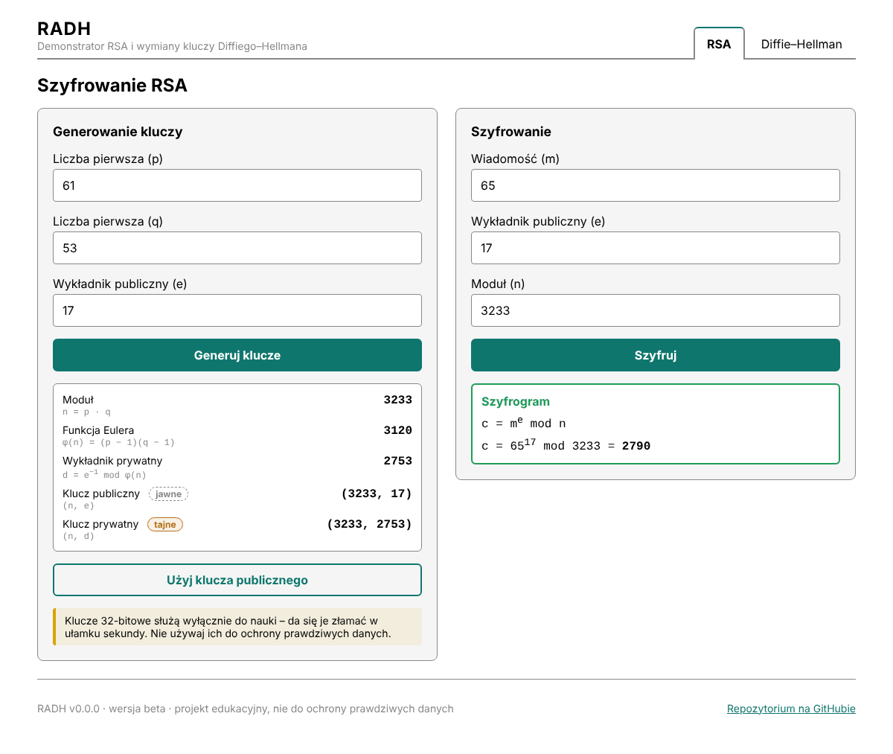
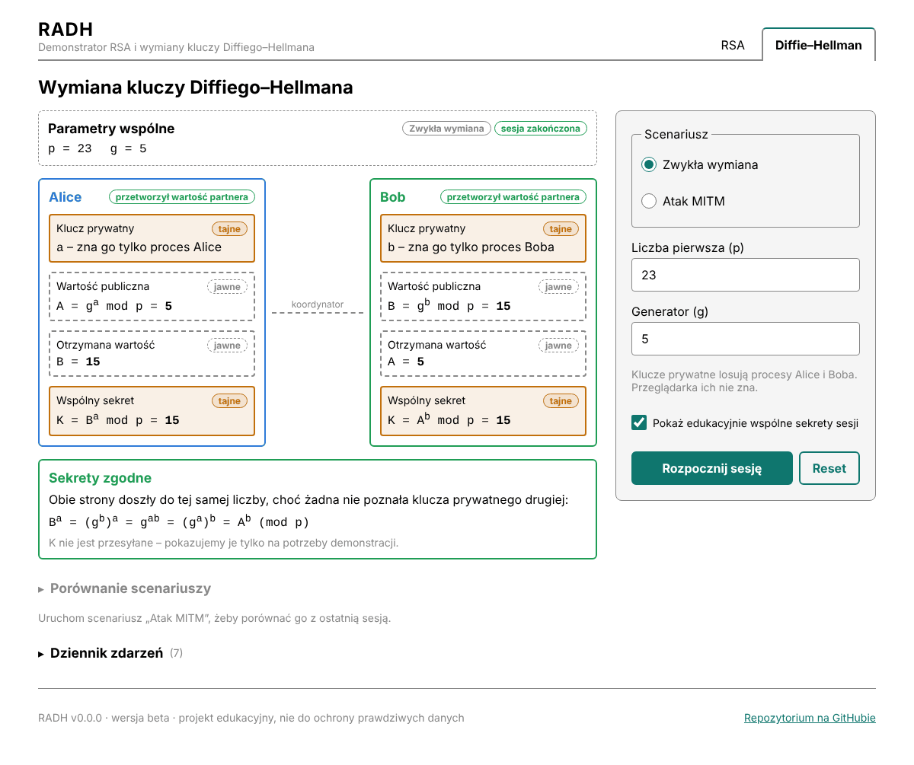
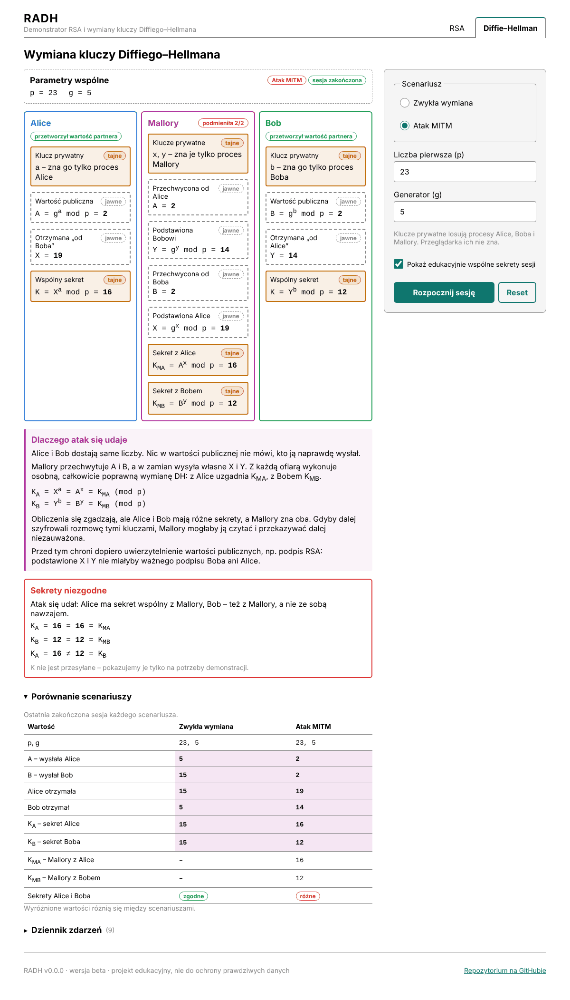

# RADH – frontend

Interfejs demonstratora RSA i wymiany kluczy Diffiego-Hellmana.
React + TypeScript + Vite.

Frontend nie wykonuje obliczeń kryptograficznych – wysyła dane do backendu
FastAPI i wyświetla jego odpowiedź.

## Interfejs

Aplikacja ma dwie zakładki: **RSA** (generowanie kluczy i szyfrowanie) oraz
**Diffie–Hellman** (wymiana kluczy, także w scenariuszu ataku MITM).
Zmiana zakładki nie usuwa wpisanych danych ani wyników.

Interfejs działa na komputerach, tabletach i telefonach (sprawdzony przy
szerokościach 360, 390, 768 i 1440 px):

- na wąskim ekranie panele układają się jeden pod drugim, formularz DH stoi
  nad przebiegiem sesji, a po starcie strona przewija się do wyniku;
- dziennik zdarzeń pokazuje każde zdarzenie jako kartę, a porównanie
  scenariuszy zostaje zwartą tabelą – bez przewijania w poziomie;
- przyciski, pola, zakładki i nagłówki zwijanych sekcji mają co najmniej
  44 px wysokości, wygodne do obsługi palcem;
- wszystko da się obsłużyć klawiaturą (zakładki strzałkami ←/→).







Wspólny wygląd obu widoków:

- `src/index.css` – zmienne stylu: kolory (w tym uczestników i rodzajów danych),
  czcionki, rozmiary tekstu, odstępy, zaokrąglenia; jasny i ciemny motyw
  według ustawień systemu.
- `src/ui.tsx` – wspólne przyciski, plakietki („tajne”, „jawne”, stany)
  i komunikaty błędów oraz ostrzeżeń.
- Wersja w stopce pochodzi z pola `version` w `package.json`.

## Wymagania

- Node.js w wersji 20.19+ lub 22.12+ (razem z nim instaluje się `npm`).
  Sprawdzenie: `node -v`.

## Instalacja zależności

Z głównego katalogu:

```bash
cd frontend
npm install
```

Wystarczy raz po sklonowaniu repozytorium i ponownie, gdy zmieni się
`package.json`. Katalog `node_modules/` nie trafia do repozytorium.

## Uruchomienie w trybie deweloperskim

```bash
npm run dev
```

Aplikacja będzie dostępna pod adresem http://localhost:5173/.
Zmiany w plikach w `src/` widać od razu po zapisaniu.

### Połączenie z backendem

W trybie deweloperskim Vite przekierowuje żądania `/api/...` do backendu
pod adresem `http://127.0.0.1:8000` (ustawienie `server.proxy` w
`vite.config.ts`). Dzięki temu nie trzeba konfigurować CORS.

Aby szyfrowanie działało, backend FastAPI musi być uruchomiony na porcie 8000
– instrukcja w [`backend/README.md`](../backend/README.md). Frontend i backend
uruchamia się w dwóch osobnych terminalach.

Bez backendu interfejs się uruchomi, ale po kliknięciu „Szyfruj” pokaże
komunikat o braku połączenia z backendem.

Szybkie sprawdzenie: dla `m = 65`, `e = 17`, `n = 3233` interfejs powinien
pokazać szyfrogram `2790`.


### Generowanie kluczy RSA

Panel „Generowanie kluczy” wyznacza parę kluczy z podanych `p`, `q` i `e`.
Wszystkie wartości (`n`, `φ(n)`, `d`) liczy CryptoCore przez endpoint
`POST /api/v1/rsa/demo/keygen` – kontrakt i kody błędów w
[`backend/README.md`](../backend/README.md).

- Pierwszość `p` i `q`, zakres modułu oraz warunek `NWD(e, φ(n)) = 1` sprawdza
  backend; frontend pokazuje jego komunikat.
- Przycisk „Użyj klucza publicznego” wpisuje `e` i `n` do formularza szyfrowania.
- Po zmianie biblioteki C trzeba ją przebudować i zrestartować backend.
  Bez tego generowanie zwróci „Nie znaleziono zasobu” (stary backend) albo
  błąd niedostępnego CryptoCore (stara biblioteka).

Szybkie sprawdzenie: dla `p = 61`, `q = 53`, `e = 17` interfejs powinien pokazać
`n = 3233`, `φ(n) = 3120`, `d = 2753`, a po użyciu klucza publicznego
wiadomość `m = 65` zaszyfruje się do `2790`.

### Zakładka Diffie–Hellman

Obecny klient korzysta wyłącznie z API v2 i niezależnych procesów
nodes.multi_session_cli. Najprościej uruchomić pięć usług przez Compose według
[głównego README](../README.md). W trybie deweloperskim backend i węzły wymagają
plików tokenów zgodnie z [kontraktem backendu](../backend/MULTI_SESSION.md).
Nie używaj transportu v1 z backend/DH_SESSIONS.md do obecnego UI.

Każda karta ma własną sesję. Koordynator może równocześnie obsługiwać normal
oraz MITM wielu kart, a lokalna tabela porównania zachowuje ukończone scenariusze.
Mallory jest wymagana tylko w MITM. K wymaga zgody użytkownika i flagi
--allow-diagnostics danego węzła. Compose losuje wykładniki lokalnie; małe liczby
edukacyjne mogą dać równe K nawet w MITM. Stałe wektory opisane w nodes/README.md
służą testom pojedynczych agentów, nie konfiguracji sekretów runtime v2.

## Kompilacja produkcyjna

```bash
npm run build
```

Polecenie sprawdza typy TypeScript i buduje aplikację do katalogu `dist/`.
Podgląd zbudowanej wersji: `npm run preview`.

## Pozostałe polecenia

- `npm run lint` – sprawdzenie kodu linterem (oxlint).
- `npm test` – testy klienta API i zachowania UI (Vitest).

## Wielosesyjny klient DH (#70)

Zakładka DH korzysta z koordynatora API v2 z #69 / PR #85 oraz procesów
wielosesyjnych z #68 / PR #82. Uruchomienie wszystkich komponentów wymaga
wspólnej migracji. Transport i tokeny ról opisuje `backend/MULTI_SESSION.md`.
Dla tego klienta uruchom backend oraz `nodes.multi_session_cli` z tokenami ról,
a frontend przez Vite (`npm run dev`), albo użyj zintegrowanego Compose v2
z #87 opisanego w głównym README. Proxy i procesy Compose są przełączone na v2.

Klient pobiera epoch z `GET /api/v2/dh/nodes`, tworzy sesję z
`Idempotency-Key` i `X-Backend-Epoch`, a następnie zachowuje
`session_id`, token właściciela oraz epoch w `sessionStorage` danej karty.
Każdy odczyt i zapis własnej sesji używa Bearer. Odświeżenie strony odzyskuje
wyłącznie tę sesję. Reset usuwa własny rekord przez DELETE i pozwala świadomie
porzucić niepotwierdzoną próbę tworzenia.

Próba create zapisuje klucz i parametry przed wysłaniem. Kolejne świadome
kliknięcie może powtórzyć ją przez maksymalnie 60 sekund z tym samym kluczem.
Zmiana parametrów, epoch lub przekroczenie czasu wymaga Reset.
Błąd startu zachowuje poświadczenie, umożliwiając ponowienie albo usunięcie.

Żądania mają timeout i AbortController. Reset/nowa operacja zwiększa numer
żądania i przerywa poprzednią operację. Polling stanu i historii jest sekwencyjny,
co 2 sekundy. Przejściowe błędy respektują Retry-After, z ograniczonym
30-sekundowym oknem ponowień od utraty kontaktu. Obcy ID nie może dostać
poświadczenia zapisanej sesji. Spóźniony błąd starego ID nie usuwa nowszego tokenu.

Diagnostyka K wymaga jawnego zaznaczenia pola przed utworzeniem sesji oraz
zgody węzła. Expired czyści K z widoku i zatrzymuje polling, zachowując możliwość
DELETE w czasie retencji. Odpowiedź 404/410 lub zmiana epoch usuwa stare
poświadczenie. Własne ukończone scenariusze nadal można porównywać w pamięci karty.

Testy jednostkowe klienta API i poświadczeń uruchamia polecenie:

```sh
npm test -- tests/dhApi.unit.test.tsx
```

Testy używają atrap fetch i storage. Weryfikacja dwóch rzeczywistych przeglądarek
i procesów z backendem należy do QA #71. Build i lint uruchamia się standardowymi
poleceniami `npm run build` i `npm run lint`.


## Lokalny Compose DH v2 — #87

Pełne środowisko uruchamiaj według [głównego README](../README.md).
Produkcyjny build React serwuje Nginx pod localhost/127.0.0.1 z portem
RADH_HTTP_PORT (domyślnie 8080). Frontend nie ma tokenów ról; używa jedynie
poświadczenia własnej sesji per karta. Internal i stare sesje v1 są blokowane.

Diagnostyka wymaga dwóch zgód: RADH_DIAGNOSTICS=1 przy uruchomieniu węzłów
oraz opt-in użytkownika w UI. Przy 0 endpointy diagnostyczne zwracają null.
Rzeczywisty poprawny epoch różny od zapisanego oznacza restart; brak epoch
w błędzie proxy nie usuwa poświadczenia. Brak/niepoprawny epoch w sukcesie v2
to INVALID_RESPONSE. Nadal usuwamy poświadczenie przy potwierdzonym 404/410
backendu. 429/503 przekazuje Retry-After bez automatycznego odtwarzania sesji.

Regresja proxy: `npm test -- tests/dhApi.unit.test.tsx`; całość: `npm test`,
`npm run lint`, `npm run build`. Testy fetch nie zastępują smoke rzeczywistych usług.